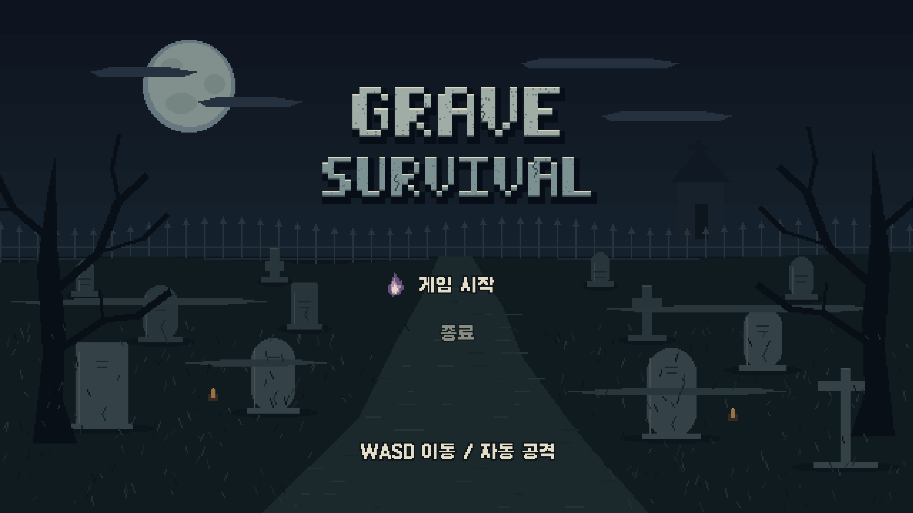
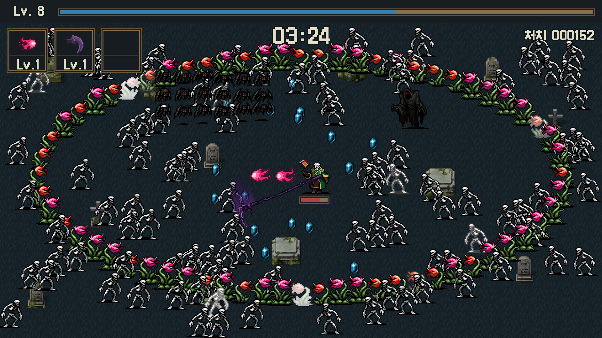
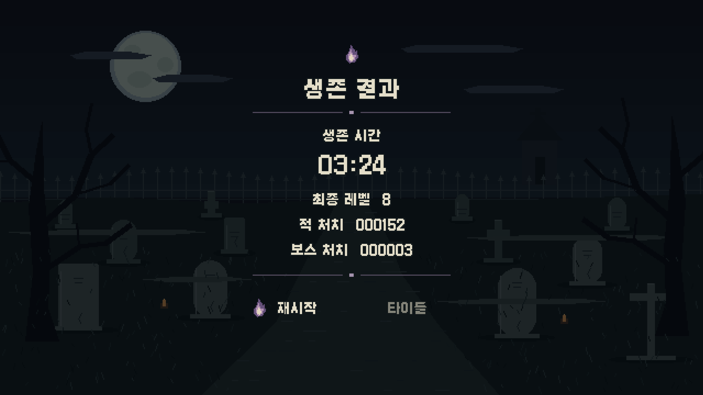

# SurvivalGame 게임 기획서

- 작성자: 이주한
- 작성일: 2026.10.18
- 프로젝트명: `SurvivalGame`
- 게임명: 그레이브 서바이벌 (Grave Survival)

## 1. 게임 개요

| 항목 | 내용 |
| --- | --- |
| 장르 | 2D 탑다운 무한 생존 액션 |
| 플랫폼 | Windows PC |
| 플레이 인원 | 1인 |
| 진행 시간 | 제한 없음. 플레이어 사망 시 종료 |
| 기본 조작 | 상하좌우 이동. 공격은 자동 실행 |
| 공간 구성 | 반복 배경으로 표현하는 무한 필드 |
| 화면 구성 | 타이틀, 플레이, 결과의 3개 Scene |

플레이어는 끊임없이 등장하는 적을 피하며 자동으로 발동하는 무기로 적을 처치한다. 경험치를 획득해 레벨을 올리고, 무기를 선택하고 강화하며 가능한 오래 생존하는 것을 목표로 한다.

시간이 지날수록 적의 능력치와 출현량이 증가한다. 정해진 최종 스테이지나 승리 시점은 없으며, 이동 경로와 무기 선택에 따라 생존 기록이 달라진다.

객체의 생성·갱신·출력·제거는 공통 실행 흐름으로 관리한다. 세부 수치와 미정 항목은 구현 및 플레이 테스트를 통해 확정한다.

---

## 2. 기본 진행과 화면 구성

1. 타이틀에서 게임을 시작한다.
2. 플레이어는 시작 무기인 마법탄을 보유한 상태로 등장한다.
3. 플레이어는 이동으로 적을 피하고, 보유 무기는 각자의 규칙에 따라 자동 공격한다.
4. 보스를 제외한 적을 처치하면 경험치가 떨어진다.
5. 경험치를 모아 레벨을 올리고 무기 획득 또는 강화 등을 선택한다.
6. 시간이 지날수록 강해지는 적과 주기적으로 등장하는 보스를 상대한다.
7. 체력이 소진되면 결과 화면으로 이동한다.

```text
타이틀 Scene
  ↓ 게임 시작
플레이 Scene
  ├─ 이동 → 자동 공격 → 적 처치 → 경험치 획득
  ├─ 레벨업 → 선택 UI → 전투 재개
  └─ 사망 → 결과 Scene
               ├─ 재시작 → 새로운 플레이
               └─ 타이틀로 돌아가기
```

| 화면 | 주요 구성 |
| --- | --- |
| 타이틀 | 전용 묘지 배경, 게임 제목, 시작, 종료 메뉴 |
| 플레이 | 배경, 플레이어, 적, 공격 효과, 체력, 경험치, 레벨, 생존 시간, 무기 3칸 |
| 레벨업 UI | 플레이 화면 위에 선택 가능한 보상 표시 |
| 결과 | 어둡게 처리한 타이틀 배경, 생존 시간, 최종 레벨, 적·보스 처치 수, 재시작·타이틀 메뉴 |

레벨업 UI는 별도 Scene으로 만들지 않고 플레이 Scene 내부 상태로 처리한다. 이동은 WASD 또는 방향키, 메뉴와 보상 선택은 방향키와 Enter를 사용한다. Escape와 창 포커스 상실 시 전투를 일시 정지한다. 일시 정지와 보상 선택 상태를 별도로 관리하며, 두 상태가 모두 해제되어야 전투를 재개한다. 포커스 복귀 후에는 Escape로 직접 일시 정지를 해제한다. 기준 화면은 1280×720 창 모드이며, 실행 환경에 맞춰 창 크기를 설정한다. 타이틀·결과는 플레이 화면을 출력하지 않으며, 일시 정지는 멈춘 플레이 화면을 어둡게 덮고 메뉴를 표시한다.

**시작 화면**



**플레이 화면**



**결과 화면**



---

## 3. 플레이어와 무기 콘텐츠

플레이어의 전투 조작은 이동으로 제한한다. 방향 입력을 조합한 대각선 이동을 지원하되, 대각선과 직선 이동 속도가 같도록 처리한다.

무기는 총 4종이며 동시에 3개까지 보유한다. 마법탄으로 시작하고, 나머지 두 칸은 레벨업 선택으로 획득한다.

| 무기 | 자동 공격 방식 | 특징 |
| --- | --- | --- |
| 마법탄 | 공격 가능한 적 중 가장 가까운 적을 향해 발사 | 발사 시 방향이 결정되는 직선 투사체 |
| 낫 | 일정 주기마다 바라보는 좌우 방향으로 휘두름 | 바라보는 방향의 위쪽에서 아래쪽으로 회전하는 공격 영역에서 대상별 1회 피해 |
| 낙뢰 | 공격 가능한 적 중 무작위 대상을 선택 | 선택한 대상에게 피해와 이펙트 적용 |
| 화염 장판 | 발밑에서 플레이어를 따라다니는 상시 화염 영역 | 범위 안의 적에게 주기적으로 피해. 최대 강화 시 푸른 불꽃과 이동 속도 감소 |

무기별 공격 간격·공격력·범위·최대 레벨은 별도 수치로 관리하며 테스트 후 확정한다. 강화 시 피해량, 발사 수, 범위, 공격 횟수 등을 조정한다. 낫은 개수·회전각·범위, 화염 장판은 범위·불길의 강도를 중심으로 강화한다. 기본 방향은 오른쪽이며, 마지막 이동 방향과 마지막 좌우 방향을 각각 보관한다. 상하 이동 중에는 이전 좌우 방향을 유지한다.

---

## 4. 적

적은 행동에 따라 총 4종으로 구성하며, 일반적은 해골, 횡단적은 박쥐, 포위적은 꽃, 보스는 사신 형태의 리소스를 사용한다. 포위적의 꽃은 생성 시 두 색상 중 하나를 무작위로 선택한다. 능력치 증가를 위해 별도의 외형 종류를 추가하지 않는다.

| 종류 | 속도 | 생성과 행동 | 처치 보상 |
| --- | --- | --- | --- |
| 일반적 | 보통 | 카메라 밖 일정 거리 범위에서 무작위 개별 생성 후 플레이어 추적 | 경험치 |
| 횡단적 | 빠름 | 화면 밖에서 무리로 생성 후 정해진 한 방향으로 횡단 | 경험치 |
| 포위적 | 매우 느림 | 플레이어 주변의 화면 밖 가로로 긴 타원 둘레에 촘촘히 생성 후 각 개체가 플레이어 추적 | 경험치 |
| 보스 | 느림 | 화면 밖에서 주기적으로 생성되어 플레이어 추적. 높은 체력 보유 | 보상 선택 기회 1회 |

포위적은 높은 체력과 촘촘한 타원형 배치로 퇴로를 압박하지만, 이동 목표는 플레이어의 현재 위치이다. 따라서 플레이어가 이동하면 타원형이 흐트러질 수 있으며, 플레이어가 멀리 이동하면 추격이 어려워진다.

적의 이동 애니메이션과 피격·사망 효과를 활용해 행동과 피해 여부를 표현한다. 프레임 규격과 재생 정보는 리소스 규격 문서에서 관리한다.

---

## 5. 좌표·이동·카메라 시스템

### 5.1 월드 좌표와 화면 좌표

플레이어·적·투사체·경험치는 모두 월드 좌표를 가진다. 이동과 충돌은 월드 좌표로 계산하고, 출력할 때 화면 좌표로 변환한다.

```text
화면 좌표 = 객체의 월드 좌표 - 카메라의 월드 좌표 + 화면 중앙
카메라의 추적 목표 = 플레이어의 월드 좌표
```

카메라는 객체 이동 이후 `LateUpdate`에서 플레이어를 약하게 부드럽게 추적한다. 출력 좌표에는 실제 카메라 위치를 사용하며, UI는 화면 좌표로 고정한다.

### 5.2 이동과 배경

- 이동량은 이동 방향, 속도, 경과 시간으로 계산한다.
- 방향 벡터를 정규화해 대각선 이동 속도를 일정하게 유지한다.
- 배경은 카메라 위치에 따라 필요한 타일만 반복 출력하고, 충돌 없는 장식을 드물게 배치한다.
- 화면 밖 객체는 출력을 생략할 수 있지만, 이동·생성·제거 판단은 별도로 수행한다.
- 필드는 모든 방향으로 자유롭게 이동할 수 있는 반복 배경으로 구성한다.

---

## 6. 전투·충돌 시스템

### 6.1 공격 실행

주기적으로 발동하는 무기는 독립적인 공격 타이머를 가진다. 공격 간격이 지나면 해당 무기의 대상 선정과 공격 함수를 실행한다. 자동 조준의 탐색 범위는 무기 설정으로 분리한다.

마법탄과 낙뢰처럼 대상이 필요한 무기는 대상이 없으면 공격 준비 상태를 유지한다. 게임 시작·무기 획득 시에도 공격 준비 상태로 시작한다. 실제 공격 시작 시 쿨타임을 초기화하고 연속 공격 중에도 진행하며, 연속 공격 종료와 쿨타임 충족 후 다음 공격을 시작한다. 낫은 적의 유무와 관계없이 주기적으로 발동하고, 화염 장판은 보유 중 플레이어를 따라 상시 유지한다. 낫의 좌우 방향은 발동 시 확정하고, 플레이어 위치와 날의 회전 궤적을 따라가는 원형 콜라이더로 판정한다. 여러 낫은 같은 시작각에서 순차적으로 발동하며, 회전각과 회전속도는 별도 설정으로 관리한다. 낙뢰의 연속 공격은 유효한 대상이 부족하면 남은 횟수를 생략한다.

공격 생성과 피해 판정을 분리하여 투사체·범위·대상 선택 공격을 지원한다. 공격 발동 조건과 방향 선정은 별도 설정으로 두어, 마지막 이동 방향으로 발사하는 투사체 등에도 같은 구조를 사용한다.

| 공격 종류 | 주요 설정 |
| --- | --- |
| 공통 | 피해량, 공격 간격, 레벨, 아이콘, 공격 리소스 |
| 투사체 | 발사 수, 발사 각도 간격·지연, 속도, 최대 적중 수, 최대 이동 거리, 수명 |
| 범위 | 단발·지속 모드, 반지름, 유지 시간·상시 유지, 피해 주기, 생성 위치와 시전자 추적 여부, 회전각·회전속도·발동 수·순차 지연 |
| 대상 선택 | 공격 횟수·간격, 가까운 적·무작위 선택, 중복 대상 허용 여부 |

적을 고르는 탐색 거리, 투사체의 최대 이동 거리, 범위 공격의 반지름은 각각 구분한다. 공격 객체에는 발동 당시의 피해량과 설정을 전달한다.

### 6.2 충돌과 피해

기본 충돌은 `CircleCollider`의 중심 거리와 반지름 합으로 판정한다. 이미지와 별도로 로컬 반지름·중심 오프셋을 설정하고, 출력과 충돌 모두 동일한 Transform의 위치·회전·Scale을 반영한다. 원형 공격의 크기는 균일 배율로 조정한다. 화염 장판은 이미지의 바닥 영역에 맞춘 타원형 범위로 판정한다.

| 판정 대상 | 처리 |
| --- | --- |
| 플레이어 ↔ 적 | 접촉 피해 처리 |
| 공격 ↔ 적 | 무기 규칙에 따른 피해 처리 |
| 플레이어 ↔ 경험치 | 고정 획득 반경 안에서 경험치 획득 |
| 적 ↔ 적 | 겹침을 완화하는 위치 보정. 횡단적이 포함된 쌍은 보정하지 않음 |

피해를 받은 객체는 체력을 감소시키고, 체력이 0 이하이면 사망을 처리한다. 횡단적도 플레이어 접촉 피해와 무기 명중 판정은 동일하게 적용하며, 다른 적에게 막히거나 밀리지 않고 통과한다.

동일한 공격이 여러 프레임에 걸쳐 겹치더라도 의도하지 않은 연속 피해가 발생하지 않도록 한다. 단발 범위 공격은 유지 시간 동안 대상별 1회, 투사체는 동일 대상 1회, 지속 범위 공격은 대상별 피해 주기에 따라 적용한다. 화염 장판은 대상별로 피해 기록을 가지며 최초 접촉 시 즉시 피해를 준다. 같은 장판에서 나갔다 다시 들어와도 기존 피해 대기시간을 유지한다. 최대 강화 시 이동 속도 감소는 영역 안에서만 적용하고 벗어나면 해제하며, 감소율은 테스트로 조정한다.

플레이어는 먼저 발생한 유효 피해를 받고 일정 시간 무적이 된다. 같은 충돌 갱신에서 여러 피해가 발생하면 가장 높은 피해 1회만 적용한다. 적은 피격 무적 없이 추가 피해를 받는다. 피격은 이동 위치를 바꾸지 않으며, 접촉 피해와 무적 시간은 테스트로 조정한다. 사망 처리는 한 번만 실행하여 경험치와 처치 기록이 중복 지급되지 않도록 한다.

---

## 7. 경험치·성장·장비 시스템

### 7.1 경험치 획득

보스를 제외한 적은 처치 위치에 경험치를 떨어뜨린다. 경험치 획득 반경은 고정이며 장비나 성장에 의해 증가시키지 않는다.

레벨이 높아질수록 다음 레벨에 필요한 경험치가 증가한다. 초반에는 완만하게 증가하고 후반으로 갈수록 증가 폭이 커지는 함수를 사용한다. 구체적인 공식과 수치는 플레이 테스트로 결정한다.

레벨업에 사용하고 남은 경험치는 유지한다. 한 번에 여러 레벨이 상승하면 선택을 순서대로 처리한다.

### 7.2 레벨업 선택

레벨업 시 전투를 일시 정지하고 선택 UI를 표시한다. 선택 중에는 이동·공격·적 출현·생존 시간이 진행되지 않으며, UI 입력은 유지한다.

| 상태 | 선택 가능한 보상 |
| --- | --- |
| 무기 슬롯에 여유가 있음 | 새로운 무기 획득, 보유 무기 강화, 체력 회복 |
| 무기 슬롯이 가득 참 | 보유 무기 강화, 체력 회복 |
| 모든 슬롯이 차고 모든 장착 무기가 최대 레벨 | 체력 회복 또는 전체 무기 피해 배율 +5%p |

최대 3개의 유효한 선택지를 중복 없이 표시하는 구성을 기본으로 한다. 선택 가능한 후보가 적으면 실제 후보 수만 중앙에 정렬하며, 1개여도 선택 확인을 받는다. 최대 레벨 무기는 일반 강화 후보에서 제외한다.

후반 피해 배율 증가는 100% → 105% → 110%처럼 합산하며, 이번 플레이에만 적용한다. 새 게임을 시작하면 초기화한다. 회복량은 최대 체력의 20%이며 최대 체력을 넘지 않는다. 체력이 가득 차 있어도 회복 선택지는 표시한다.

### 7.3 무기 보유 정보

`WeaponInventory` 컴포넌트는 무기 슬롯과 각 무기의 종류·레벨을 관리한다. 초기 슬롯 수는 3칸이며 설정값으로 관리한다. 신규 획득은 빈 슬롯에 등록하고, 보유 무기 강화는 해당 무기의 성능 정보를 갱신한다. 상시 유지되는 화염 장판에도 강화와 전체 무기 피해 배율 증가를 즉시 반영한다.

획득한 무기는 해당 플레이가 끝날 때까지 유지한다. 화면 구석의 무기 UI는 슬롯별 아이콘과 현재 레벨을 표시하고, 획득·강화 이벤트에 맞춰 갱신한다. 최대 단계에 도달한 무기는 슬롯을 금색으로 표시한다.

---

## 8. 적 출현·난이도·보상 시스템

### 8.1 출현 위치와 주기

종류별 출현 시점은 주기로 관리하고, 위치와 진입 방향은 무작위로 결정한다.

- 일반적: 카메라 사각 영역을 바깥으로 확장한 범위 중 화면 밖 부분에서 위치를 선택한다.
- 횡단적: 화면 밖 한쪽에서 무리를 생성한다. 화면을 가로지르는 이동 방향을 생성 시 정하고 유지한다.
- 포위적: 플레이어를 중심으로 실제 카메라 영역을 감싸는 가로로 긴 타원 둘레에 촘촘히 배치한다. 생성 위치는 모두 화면 밖에 둔다.
- 보스: 별도의 출현 주기에 따라 카메라 밖에서 생성한다. 정확한 주기는 추후 결정한다.

일반적은 지속적으로 등장하며, 횡단적·포위적·보스는 주기적인 압박을 제공한다. 생성 거리·무리 크기·출현 간격은 조정 가능한 값으로 분리한다.

### 8.2 난이도 증가

생존 시간이 길어질수록 새로 생성되는 적의 체력·접촉 피해와 출현량을 증가시킨다. 속도 차이는 각 종류의 행동을 구분하는 기준으로 유지한다. 증가 주기와 수치는 테스트로 조정한다.

동시 적 수와 최소 생성 간격에 상한·하한을 두어 객체 수가 무제한 증가하지 않도록 한다. 보스를 포함한 전체 적 수에 공통 상한을 적용하며, 보스의 동시 등장 수는 전체 상한 안에서 허용한다. 출현 시 남은 자리만큼 생성하고 초과분은 이월하지 않는다. 상한 수치는 성능 측정 후 결정한다.

### 8.3 처치와 거리 제거

처치된 일반적·횡단적·포위적은 경험치를 지급한다. 보스는 처치 즉시 레벨업과 같은 보상 선택 요청 1회를 등록하며, 플레이어 레벨·경험치는 변경하지 않는다. 보상 선택창은 해당 프레임의 피해·사망 처리가 끝난 뒤 표시한다. 경험치 레벨업과 동시에 발생하면 경험치 보상부터 순서대로 선택한다. 같은 갱신에서 플레이어가 사망하면 보상 선택보다 사망 처리를 우선한다.

플레이어에게서 지나치게 멀어진 적의 제거를 적용해 성능을 관리한다. 거리 제거는 처치와 구분하여 경험치·보상·처치 기록을 지급하지 않는다. 보스는 거리 제거 대상에서 제외하며, 기준 거리는 화면 크기를 고려해 조정한다.

---

## 9. 프로그램 구조와 객체 실행 흐름

### 9.1 설계 방향

glc의 창·입력·출력·시간 기능 위에 게임 객체 관리 구조를 구성한다. 객체가 Transform을 가지고 공통 실행 흐름에 참여하도록 하되, 게임에 필요한 범위의 단순한 구조를 목표로 한다.

`Object`를 공통 기반으로 `GameObject`와 `Component`를 구성한다. `Component` 아래에 활성 제어를 담당하는 `Behaviour`, 실행 함수를 제공하는 `MonoBehaviour`를 두며, 게임 행동은 컴포넌트로 부착한다.

| 객체·기능 | 역할 |
| --- | --- |
| `GameMain` | glc 실행 흐름 연결, Scene 전환 |
| `GameManager` | 싱글톤으로 게임 상태, 생존 시간, 처치 기록 관리 |
| `Scene` | 객체 목록과 생성·제거 요청 관리 |
| `TitleScene` / `GameplayScene` / `ResultScene` | 화면별 입력과 진행 처리 |
| `Object` | 식별자, 이름, 제거 상태 |
| `GameObject` | 활성 상태, 필수 Transform, 컴포넌트 목록 |
| `Component` | 소속 GameObject와 Transform 접근 |
| `Behaviour` / `MonoBehaviour` | 개별 활성 상태 / 초기화·갱신 등 실행 함수 |
| `Transform` | 월드 위치, 회전, 스케일 |
| `PlayerController` | 이동 입력, 체력, 경험치 처리 |
| `Enemy`와 적 4종 | 공통 피해·사망 처리와 종류별 이동 |
| `WeaponInventory` | 보유 Weapon 객체와 슬롯 관리, 무기 갱신 |
| `Weapon`과 공격 유형 3종 | 공격 주기·레벨 관리와 투사체·범위·대상 공격 실행 |
| `SpriteRenderer` / `Animator` | 이미지 출력·반전·출력 순서 / 프레임 재생 |
| `CircleCollider`와 충돌 처리 기능 | 원형 영역·판정 그룹 관리와 피해·획득·겹침 보정 전달 |
| 생성·풀링 기능 | 적 생성 주기와 반복 객체 재사용 |

`AddComponent<T>()`로 컴포넌트를 부착하고 `GetComponent<T>()`로 해당 형식에 맞는 첫 컴포넌트를 조회한다. 같은 구체 타입의 중복 부착은 허용하지 않는다. Transform 컴포넌트는 GameObject 생성 시 함께 만들고 유지한다. `SetActive`는 객체 전체의 참여 여부를, Behaviour의 `Enabled`는 해당 컴포넌트의 참여 여부를 제어한다.

`Scene`은 일반 C# 추상 클래스로 두고, 화면별 Scene이 이를 상속한다. 진입 시 객체와 UI를 구성하고, 갱신·출력 및 종료 시 정리를 담당한다. 객체 목록과 생성·제거 예약 처리는 공통 구현을 사용한다.

GameObject는 하나의 Scene에만 소속되며 `GameObject.Scene`으로 소속을 참조한다. Scene은 객체의 등록과 최종 제거를, GameObject는 자신의 컴포넌트와 생명주기를 관리한다. 무기와 생성기는 객체의 생성·대여와 설정을 요청하며, 생성된 공격 객체의 수명은 Scene에서 관리한다.

### 9.2 갱신과 출력

한 프레임의 기본 흐름은 다음과 같다.

```text
입력 확인
  → 현재 게임 상태 확인
  → 객체의 행동·이동·공격 갱신
  → 충돌·피해·경험치 획득 처리
  → 생성·제거 예약 반영
  → 카메라 위치 갱신
  → 월드 객체 출력
  → UI 출력
```

`Update(deltaTime)`에 프레임 경과 시간을 전달해 이동과 공격·애니메이션 타이머를 갱신한다. 이후 `LateUpdate(deltaTime)`에서 카메라를 추적한다. 비활성 객체는 갱신·충돌·출력에서 제외하며, 일시 정지는 객체 비활성화와 구분해 전투 시간의 진행을 멈춘다.

컴포넌트 부착과 설정을 마친 뒤 Scene에 등록하고 `Awake`를 한 번 호출한다. 활성 상태이면 `OnEnable`을 호출하며, `Start`는 최초 활성 갱신 전에 한 번 호출한다. 이후 `OnEnable`·`OnDisable`은 실제 활성 상태가 바뀔 때, `OnDestroy`는 최종 제거 시 호출한다. 풀에서 재사용할 때는 상태를 초기화한 뒤 활성화하며, Awake·Start를 반복 호출하지 않는다.

출력 레이어는 `Background` → `GroundEffect` → `Pickup` → `Character` → `FrontEffect` → `UI` 순서로 구성한다. 화염 장판은 GroundEffect, 투사체·낫·낙뢰는 FrontEffect를 사용한다. 같은 레이어에서는 Order가 작은 순서로 그린다. Character의 같은 Order에서는 발 기준 월드 Y좌표가 작은 객체부터 그리고, 값이 같으면 먼저 등록된 순서를 유지한다. 박쥐는 지상 캐릭터보다 높은 Order로 그린다. 렌더링 함수에서는 게임 상태를 변경하지 않는다.

### 9.3 객체별 역할과 상호작용

`GameManager`는 싱글톤 패턴으로 구성하여 프로그램 실행 중 하나의 인스턴스를 유지한다. 각 Scene은 같은 `GameManager`를 통해 게임 상태와 진행 기록을 확인한다. 게임 시작·레벨업 선택·전투 재개·사망에 따른 상태 변경을 관리하며, `GameMain`은 그 상태에 맞춰 Scene을 전환한다.

`GameMain`은 현재 Scene 하나를 실행하며, 전환 요청은 현재 프레임의 갱신이 끝난 뒤 반영한다. 재시작 시에는 진행 기록을 초기화하고 GameplayScene을 새로 생성한다. 일시 정지와 보상 선택은 Scene을 유지한 채 전투 갱신만 멈춘다.

생존 시간은 전투가 진행되는 동안에만 증가하고, 사망 시에는 기록을 확정해 결과 Scene에 전달한다. 새 게임을 시작하면 같은 인스턴스에서 이전 플레이의 진행 기록을 초기화한다. 개별 객체의 이동·공격과 생성·제거는 각 객체와 Scene이 담당한다.

적은 `Enemy`를 상속해 체력과 피해·사망 처리를 공유하고, 이동 함수는 종류에 따라 재정의한다. 일반적과 보스의 추적 계산은 함께 사용하되 속도·체력·보상으로 차이를 둔다. 갱신은 Scene → GameObject → MonoBehaviour 경로로 한 번만 수행한다. 적 목록은 대상 탐색과 개체 수 관리에 사용한다.

무기는 `Weapon`에서 공격 주기와 레벨 등 공통 정보를 관리하고, `ProjectileWeapon`·`AreaWeapon`·`TargetWeapon`이 공격 방식을 재정의한다. 마법탄은 ProjectileWeapon, 낫과 화염 장판은 AreaWeapon의 단발·지속 모드, 낙뢰는 TargetWeapon에 수치와 리소스를 설정하여 구성한다. 낙뢰는 연속 공격마다 대상을 다시 선택하며 같은 발동 내 중복 대상을 제외한다. `WeaponInventory`는 일반 C# 객체인 Weapon을 보유하고 갱신하며, 무기는 실제 공격이 발생할 때 공격용 GameObject를 풀에서 가져온다.

투사체는 이동·명중을 담당하는 컴포넌트와 SpriteRenderer·Animator·CircleCollider를, 범위 공격은 범위·피해 주기를 담당하는 컴포넌트와 SpriteRenderer·Animator·CircleCollider를 조합한다. 낙뢰는 선택한 대상에게 피해를 전달하고 해당 위치에 애니메이션 효과 객체를 생성한다. 피해 판정 시간과 효과 재생 시간은 각각 관리한다.

충돌 처리에서는 피해를 받을 수 있는 대상에 `IDamageable`을 통해 피해를 전달한다. 체력 감소와 사망 여부는 대상 객체가 판단하며, 외부에서 체력 값을 직접 변경하지 않는다. 경험치와 무기 레벨도 획득·강화 메서드를 통해 변경하여 레벨업 조건과 강화 제한을 함께 확인한다.

체력·경험치 변경과 사망은 이벤트로 전달한다. UI는 변경된 값을 화면에 반영하고, `GameManager`는 적 처치 알림을 받아 처치 수를 갱신한다. 레벨업 선택지는 보유 무기와 슬롯 상태를 기준으로 후보를 걸러 구성한다.

---

## 10. 객체 수명과 성능 관리

- 객체 목록 순회 중 직접 추가·삭제하지 않고 요청을 예약해 정해진 시점에 반영한다.
- 사망한 객체는 이후 충돌·공격 대상에서 즉시 제외하고, 목록 제거 또는 풀 반환은 안전한 시점에 수행한다.
- 적·투사체·범위 공격·경험치·효과 등 반복 생성되는 객체는 종류별 풀에서 재사용한다. 반환 시 SetActive(false)로 비활성화한다.
- 풀은 GameplayScene이 소유하며 재사용할 객체의 참조를 보관한다. 풀에 반환한 비활성 객체도 Scene 소속과 전체 객체 목록을 유지하되 갱신·충돌·출력에서 제외한다.
- 재사용 시 체력, 위치·회전·스케일, 이동 방향, 공격 타이머, 애니메이션, 피격 플래시와 적중 이력을 초기화한다.
- 적을 풀에서 꺼낼 때 재사용 회차를 증가시키고, 공격의 적중 대상은 객체 ID와 재사용 회차의 조합으로 구분한다. 공격 객체의 재사용 시에는 이전 적중 기록을 비운다.
- 풀링과 충돌 검사 비용은 구분한다. 먼저 동시 객체 수를 제한하고 실제 성능을 측정한다.
- 공간을 격자로 나누어 가까운 객체끼리 필요한 충돌과 적 겹침 보정을 검사한다.
- 경험치 보석은 화면 밖으로 충분히 멀어지고 일정 시간 이상 방치된 경우 제거한다. 거리와 시간은 테스트로 조정한다.
- 새 게임에서는 이전 객체·타이머·경험치·무기·피해 배율이 남지 않도록 초기화한다.
- Scene 종료 시 활성·비활성 객체를 모두 한 번씩 최종 제거하고, 풀의 참조와 생성·제거 예약 및 이벤트 구독을 정리한다.
- 공유 이미지·사운드는 프로그램 단위 리소스 저장소에서 유지하고 프로그램 종료 시 해제한다.

---

## 11. 리소스 구성

적은 행동 기준 4종이며 포위적의 색상 2종을 포함해 각 외형의 프레임을 스프라이트 시트로 구성한다. 플레이어는 이동 애니메이션을 사용하며, 정지하면 현재 프레임을 유지하고 다시 이동할 때 이어서 재생한다. 적은 이동·사망 애니메이션을 사용한다. 피격 시트와 무기 이미지를 재사용한다. 리소스 출처는 `resource/resource_list.md`, 최종 파일 목록과 규격은 `resource/resource_spec.md`에서 관리한다.

```text
resource/
├─ image/
│  ├─ player/          # 플레이어
│  ├─ enemy/           # 일반적, 횡단적, 포위적, 보스
│  ├─ effect/          # 마법탄, 낫, 화염 장판, 낙뢰
│  ├─ hitflash/        # 플레이어·적의 흰색 피격 시트
│  ├─ pickup/          # 경험치 보석
│  ├─ background/      # 반복 배경·장식, 타이틀 배경
│  └─ ui/              # 메뉴, 무기·보상 아이콘, 체력·경험치 표시, 선택창
├─ font/               # 도트 폰트와 글리프 시트
└─ audio/
   ├─ bgm/             # 배경 음악
   └─ sfx/             # 공격, 피격, 획득, 레벨업, 메뉴 효과음
```

이미지는 리소스 저장소에서 한 번 불러와 공유한다. 시트의 프레임 크기와 행·열을 기준으로 영역을 나누어 Sprite로 관리하고, 프레임 목록·재생 속도·반복 여부를 AnimationClip에 보관한다. Animator는 객체별 현재 프레임과 재생 시간을 관리하며, SpriteRenderer는 선택한 프레임을 Transform과 FlipX·FlipY에 맞춰 출력한다. Sprite는 좌하단 (0, 0), 중앙 (0.5, 0.5)을 기준으로 하는 비율 피벗을 가지며, SpriteRenderer는 피벗이 Transform의 화면 위치에 맞도록 좌상단 출력 좌표를 계산한다. 크기·회전·반전도 같은 피벗을 기준으로 적용한다.

무기별 공격 방식에 맞는 애니메이션을 사용하며, 화염 장판은 플레이어를 따라 반복 재생한다. 범위 강화 시 이미지와 충돌 범위를 함께 변경하고, 공격이나 효과가 종료되면 객체를 풀로 반환한다.

피격 표현은 `HitFlash` 컴포넌트가 원본과 같은 형태의 흰색 이미지를 겹쳐 그린 뒤 점차 사라지게 처리한다. 플레이어는 피격 표현과 무적 시간을 같게 두고, 적은 별도로 관리한다. 실제 피해를 다시 받으면 피격 표현을 처음부터 재생한다.

애니메이션 시간은 게임 진행 시간과 연결해 레벨업 선택 중 전투 애니메이션도 함께 정지하도록 한다. UI 애니메이션이 필요한 경우에는 전투 정지와 분리한다.

이미지는 공통 도트 크기를 유지하고, 스프라이트 시트는 일정한 프레임 규격으로 구성한다. 객체마다 애니메이션 재생 시작 시점을 달리할 수 있다.

BGM은 타이틀·결과용과 전투용을 구분하며, 일시 정지·보상 선택 중에는 음량을 낮춘다. 효과음은 공격·피격·보상·메뉴 등 상황에 맞춰 재생하고, 화염 장판은 활성 중 반복음을 사용한다. BGM과 효과음의 음량은 별도로 관리한다.

---
